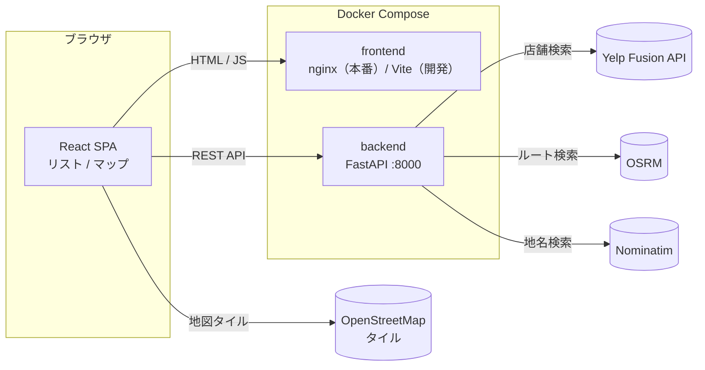

# FindRestr

エリア・現在地・ルートから飲食店を探せる Web アプリです。店舗データは Yelp Fusion API から取得し、リストと地図で表示します。

## 実装機能

### 検索

| 機能 | 内容 |
| --- | --- |
| エリア検索 | 全 47 都道府県と各県の主要な市区町村（東京都は渋谷・新宿などの繁華街単位）から選択 |
| 現在地検索 | ブラウザの位置情報で現在地を取得し、半径 1〜5km 以内を検索 |
| ルート検索 | 出発地 → 目的地のルートから 200m / 500m / 1km / 2km 以内のお店を検索。出発地には現在地も指定可。地点は駅名・住所・施設名で検索して選ぶ |
| ジャンル | 検索エリア内の店舗が持つ Yelp カテゴリを集計して選択肢を作成（件数順・日本語表記）。複数選択は OR 条件 |
| 予算 | 1 人あたり ¥0〜¥20,000 以上の範囲指定（Yelp の価格帯 $〜$$$$ を円の目安に換算） |
| 評価 | 下限・上限の範囲指定（0.0〜5.0、0.5 刻み） |

### 表示

- **リスト表示**：店舗カード（写真・ジャンル・エリア・距離・平均予算・評価・レビュー数・Yelp へのリンク）
- **マップ表示**：店舗をマーカーで表示し、クリックで詳細を表示。現在地検索では検索範囲の円、ルート検索ではルート・出発地・目的地も表示
- **並び替え**：おすすめ順（評価 × レビュー数）／評価の高い順／価格の安い順／高い順／ルート順（ルート検索時、出発地に近い順）
- 検索条件の変更は自動で反映（250ms デバウンス・古いリクエストは破棄）
- `YELP_API_KEY` 未設定時はサンプルデータ（東京 16 店舗）で動作

## 実装技術

### フロントエンド

| 技術 | 用途 |
| --- | --- |
| React 19 / TypeScript 5 | UI |
| Vite 8 | 開発サーバー・ビルド |
| Tailwind CSS v4 / shadcn/ui（Radix UI） | スタイル・UI コンポーネント（Select・Slider・Checkbox など） |
| lucide-react | アイコン |
| Leaflet + OpenStreetMap タイル | 地図表示（マップ表示に切り替えたときだけ読み込み） |
| Geolocation API | 現在地の取得 |

### バックエンド

| 技術 | 用途 |
| --- | --- |
| Python 3.12 / FastAPI / Pydantic | REST API・入力検証・レスポンスの型定義 |
| uvicorn | ASGI サーバー |
| httpx（async） | 外部 API の呼び出し（ルート検索では Yelp を最大 3 並列で呼ぶ） |

### 外部サービス

| サービス | 用途 | 備考 |
| --- | --- | --- |
| [Yelp Fusion API](https://docs.developer.yelp.com/reference/v3_business_search) | 店舗の検索（`/v3/businesses/search`） | API キーが必要。キーはバックエンドだけが持つ |
| [OSRM](https://project-osrm.org/) | 出発地 → 目的地のルート検索 | 既定は公開デモサーバー（車のみ・低頻度の利用向け・商用不可） |
| [Nominatim](https://nominatim.org/)（OpenStreetMap） | 地名・住所 → 座標 | 利用規約により、検索ボタンを押したときだけ呼ぶ |
| OpenStreetMap タイル | 地図画像 | ブラウザから直接取得 |

### インフラ

- Docker / Docker Compose（本番相当：nginx で静的配信、開発用：Vite のホットリロード）

## システム構成



- ブラウザは API キーを持たず、外部 API（地図タイル以外）はすべてバックエンド経由で呼びます。Yelp API は CORS にも対応していません。
- ルート検索の流れ：OSRM でルートを取得 → ルート上の最大 10 地点を中心に Yelp を検索 → 結果をまとめ、各店舗とルートとの最短距離・出発地からの道のりを計算して絞り込み。
  同じルートの結果は 10 分間メモリにキャッシュするので、ジャンル・評価・予算を変えても外部 API を呼び直しません。
- ジャンル・評価・予算の絞り込みはバックエンドで行います。ジャンルの選択肢は、絞り込み前のエリア内（ルート沿い）の店舗から作ります。

### API

| エンドポイント | 内容 |
| --- | --- |
| `GET /api/shops` | エリア検索（`prefecture`, `area`）・現在地検索（`lat`, `lng`, `radius`） |
| `GET /api/shops/route` | ルート検索（`olat`, `olng`, `dlat`, `dlng`, `buffer`）。ルートの座標・距離・所要時間も返す |
| `GET /api/geocode` | 地名 → 座標の候補（`q`） |
| `GET /api/health` | ヘルスチェック（データの取得元 `yelp` / `mock` を返す） |

共通の絞り込みパラメータ：`genre`（Yelp カテゴリ alias・複数可）、`min_rating`, `max_rating`, `budget_min`, `budget_max`。
詳細は起動後の http://localhost:8000/docs（Swagger UI）を参照してください。

### ディレクトリ構成

```
.
├── src/                          # フロントエンド
│   ├── App.tsx                   # ホーム画面と検索画面の切り替え
│   ├── components/
│   │   ├── ShopSearch.tsx        # 検索画面（検索条件・結果一覧・状態管理）
│   │   ├── ShopMap.tsx           # 地図表示（Leaflet）
│   │   ├── RouteSearchFields.tsx # ルート検索の入力（出発地・目的地・距離）
│   │   └── ui/                   # shadcn/ui コンポーネント
│   ├── hooks/useGeolocation.ts   # 現在地の取得
│   └── data/
│       ├── restaurants.ts        # 型・検索条件・API クライアント
│       └── areas.ts              # 都道府県・市区町村
├── backend/                      # バックエンド（FastAPI）
│   ├── main.py                   # エンドポイント
│   ├── yelp.py                   # Yelp Fusion API クライアント
│   ├── routing.py                # OSRM・Nominatim・ルートからの距離計算
│   ├── shops.py                  # 絞り込み・ジャンル集計・サンプルデータ
│   └── categories_ja.py          # Yelp カテゴリの日本語名
├── Dockerfile                    # フロントエンド（dev / build / prod）
├── docker-compose.yml            # 本番相当
└── docker-compose.dev.yml        # 開発用（ホットリロード）
```

## 設定

ルートの `.env`（Docker）またはシェルの環境変数（ローカル）に設定します。

| 変数 | 内容 | 既定値 |
| --- | --- | --- |
| `YELP_API_KEY` | Yelp Fusion API のキー（[発行ページ](https://www.yelp.com/developers/v3/manage_app)） | 未設定ならサンプルデータ |
| `OSRM_URL` | OSRM サーバーの URL | `https://router.project-osrm.org` |
| `OSRM_PROFILE` | OSRM のプロファイル | `driving` |
| `VITE_API_BASE` | フロントから見た API の URL | `http://localhost:8000` |

### データについての注意

- 予算は Yelp の価格帯（$〜$$$$）を円の目安（¥1,000 / ¥3,000 / ¥7,000 / ¥15,000）に換算しています。
- Yelp はカテゴリ名を英語で返すため、`backend/categories_ja.py` の対訳で日本語にしています。対訳がないものは英語のまま表示されます。
- 1 回の検索で Yelp から取得するのは最大 50 件（ルート検索は最大 10 地点 × 50 件）です。ジャンルの選択肢もこの範囲から作ります。

## Docker で起動

```bash
# 本番相当（フロント http://localhost:8080 / API http://localhost:8000/docs）
docker compose up --build

# 開発用・ホットリロード（フロント http://localhost:5173）
docker compose -f docker-compose.yml -f docker-compose.dev.yml up --build
```

依存パッケージを追加したあとは、コンテナ内の `node_modules` を作り直してください。

```bash
docker compose -f docker-compose.yml -f docker-compose.dev.yml up -d --build --renew-anon-volumes frontend
```

## ローカルで起動（Docker なし）

```bash
# バックエンド (FastAPI) — http://localhost:8000
# （Ubuntu などはシステムの pip が使えないので venv を作る）
cd backend
python3 -m venv .venv && .venv/bin/pip install -r requirements.txt
.venv/bin/uvicorn main:app --reload --port 8000

# フロントエンド (Vite)
pnpm install && pnpm dev
```

動作確認:

```bash
curl "http://localhost:8000/api/shops?prefecture=東京都&area=新宿&min_rating=4"
curl "http://localhost:8000/api/shops/route?olat=35.6896&olng=139.7006&dlat=35.6812&dlng=139.7671&buffer=500"
```
